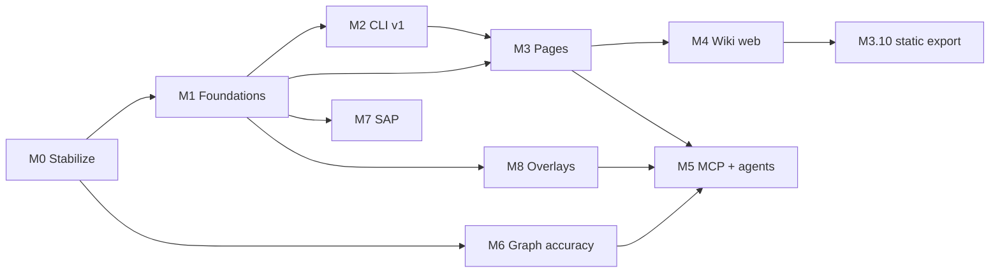

# ai-discovery v1 Roadmap

_Last reworked 2026-10-31 for the agent-platform direction — see `research/agent-platform-assessment.md`._

No dates — status is the commitment (repowise-style). Item-level status lives in `milestones/*.md`; run `python scripts/roadmap_lint.py --board` for live counts. This table was last refreshed 2026-10-31.

| Status | Meaning |
|---|---|
| Done | Merged to main |
| In progress | Claimed on a branch |
| Planned | Committed, not started |
| Exploring | Good idea, not committed; never auto-picked |

## Milestones

| # | Milestone | Goal | Status |
|---|---|---|---|
| M0 | [Stabilize & measure](milestones/M0-stabilize.md) | Fix defects that survive any rewrite; golden harness; baseline vs repowise | Done |
| M1 | [Foundations (strangler)](milestones/M1-foundations.md) | Paths, config v2, store + lock, stages, llm/, edge contract, secret masking | Done |
| M2 | [CLI v1 (hard break)](milestones/M2-cli-v1.md) | 11 commands (+ `evidence` in M8), cost gate, status/doctor, freshness triggers | In progress |
| M3 | [Page model & keyless wiki](milestones/M3-pages.md) | Deterministic pages, prose layer, incremental parity | In progress |
| M4 | [Wiki web](milestones/M4-wiki-web.md) | React SPA in wheel, `serve`, notes, annotations | In progress (M4.4 graph explorer left) |
| M5 | [MCP + agent platform](milestones/M5-mcp-agents.md) | Knowledge layer for autonomous agents: query, impact, MCP (stdio + HTTP), skills, write-back, safety envelope, verification contract, agent eval | In progress — L3 built; M5.7.b eval run awaits owner approval; M5.8 Exploring |
| M6 | [Graph accuracy](milestones/M6-graph-accuracy.md) | Walker, C#/Java/VB/Vue gaps, DI, SQL/procs/MyBatis, CI gates | In progress (M6.13 gates, M6.2 C# done) |
| M7 | [SAP ABAP + UI5](milestones/M7-sap.md) | abapGit + Fiori/UI5 extraction | On hold (owner, 2026-11-02) |
| M8 | [Evidence overlays](milestones/M8-overlays.md) | Git history (+ risk), coverage, OTLP spans, rationale (`get_why`) | Planned |

## Slices

**Slice 1 — first lovable slice (★ items):** keyless `discover init → scan → serve` with the SPA wiki.
Critical path: M0.2 → M0.6 → M0.10 → M2.3 → M3.5 → M4.3 → M4.5, with M1.2 → M1.4 → M1.5 → M3.1 → M3.2/M3.3 and M4.1/M4.2 in parallel.

**Slice 2:** prose layer + cost gate (M1.10–M1.11, M2.4, M3.7–M3.8). The legacy ASIS/ASD/ASSC SDLC tree is dropped (owner decision 2026-10-08); its LLM stages are deleted in M3.7.

**Slice 3 — agent platform (knowledge layer; `research/agent-platform-assessment.md`):** gated for "GA" on M6.13 accuracy thresholds.
- *3a, to readiness L2:* M5.1 → M5.2 → M5.3 → M5.14 + M5.11 → M5.4 / M5.5, with M2.8 (freshness, after M3.6) in parallel.
- *3b, to L3:* M1.13 → M5.12 (safety); M5.6 → M5.15 (verification); M5.10 (write-back, after M4.6); M8.1 → M8.5 (risk, `get_why`); M5.9 (HTTP); M5.13 (ledger).
- *L4:* M5.7 eval with bare, ai-discovery, headless-autonomous and (black-box) repowise arms.

**Parallel tracks:** M6 (lane C) — parser-coverage items (M6.2, M6.3, M6.5) can start after M0.3; walker/resolution items wait for the M0.12 baseline; M7 (lane F) on hold by the owner (2026-11-02); M8 (lane G) after M1.12, low priority.

## What we are not building

| Not building | Why |
|---|---|
| A built-in agent runtime / BA orchestrator, or executing user code | Owner decisions 2026-10-08 and 2026-10-31: external agents (Claude Code, Codex, Agent SDK, CI bots) orchestrate; we are their knowledge layer (MCP tools, skills, safety and verification contracts) |
| Multi-tenant / RBAC, job queue, webhooks/scheduler | One project per process, single-user and air-gapped installs; CI or the M2.8 git hook drives scans |
| Dead code, health scores, refactoring codegen, security scanning | Outside brownfield-understanding scope (`research/repowise-benchmark.md` E5) |
| Agent transcript mining | Privacy and unmeasured value; revisit after M5.13 ledger data |
| A graph database (Neo4j/Memgraph) | SQLite + in-memory traversal is sufficient at our scale and keeps install trivial |
| Claims of method-level runtime tracing via eBPF/OTel auto-instrumentation | Verified false: those give request-level spans only (`research/research-doc-review.md`) |
| An LLM PR reviewer | Non-deterministic; out of scope |
| A Node runtime dependency | Air-gapped enterprise installs; SPA is prebuilt into the wheel |
| Multi-project server process | One project per process keeps config/state simple |
| Pooled cross-repo recall numbers | Misleading (benchmark protocol) |
| Dates on this roadmap | Status is the commitment |
| SDLC export profile (ASIS/ASD/ASSC/PF/BPMN/DMN/EARS folder tree) | Owner: not needed (2026-10-08). Entity FSM/DMN/EARS and flows live on wiki pages instead |

**Exploring (not committed):** multi-repo workspace (old `federate`; trigger: ≥ 2 pilot users with split frontend/backend repos *and* an M5.7 task needing cross-repo impact), output languages other than English, presentation mode, SessionStart hook (M5.8, A/B-gated), profiler stacks (M8.4). Promoted to Planned on 2026-10-31: MCP HTTP transport (M5.9), secret masking (M1.13), generated agent instructions (M5.11).

## Top risks

| Risk | Mitigation |
|---|---|
| Strangler regressions in LLM phases | Recorded-response golden harness (M0.2); move code verbatim before changing it (ADR-0003) |
| MCP/impact answers only as good as the graph | Edge contract early (M1.12); CI accuracy gates (M6.13); unknowns surfaced; `may_break` wording |
| Edge contract lowers recall | Measure vs M0.12; report unresolved counts; tune per origin rather than re-adding guesses |
| Thin ground truth for WebForms / VB.NET / JSP / CP949 / ABAP | `../sample-apps` covers only ASP.NET Core + Spring; add repos when available; synthetic encoding fixtures; assumptions labelled (Unverified) |
| Enterprise install (Windows, air-gapped, pysqlite3/sqlite-vec/FTS5) | Wheel smoke test (M4.5); `doctor` checks (M2.5); vendored web assets |
| Parallel-agent conflicts | Lanes with single owners, claim-before-branch, migration number reservations |
| AGPL contamination from repowise | ADR-0006 clean-room rule + PR attestation |
| Prompt injection through repo content (comments, docs, notes) served to agents | M5.12 untrusted-field envelope + flags; M1.13 masking; agents keep responsibility |
| Agent write-back polluting facts | Separate annotation tables, `signer_kind`, proposed-until-human-confirmed (M5.10); graph never edited by agents |
| Stale index trusted by an autonomous agent | M2.8 git hook / watch; `_meta.behind_by` on every answer; skills stop on staleness |
| Hooks or instruction blocks that cost context without changing behaviour | M5.8 randomised A/B; M5.11 token cap; M5.13 ledger |
| Remote MCP exposed without auth | M5.9 refuses non-loopback binds without a token |

## Owner decisions (2026-10-08)

1. **License:** AGPL-3.0 (`LICENSE`, `pyproject.toml`). The repowise no-copy rule stays as an engineering policy (ADR-0006).
2. **Benchmark apps:** `../sample-apps/eShop` (ASP.NET Core) and `../sample-apps/spring-petclinic` (Java/Spring). No WebForms, JSP, VB.NET or ABAP repo yet — add one when available.
3. **SDLC export profile:** not needed; dropped (formerly M3.9).
