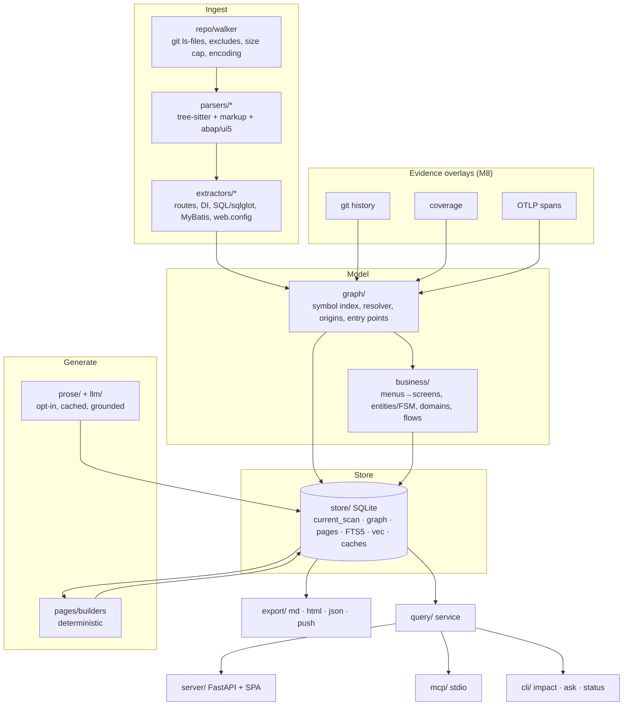

# Architecture v1 (target)

- **Status:** Accepted (target state; reached incrementally via M1–M5)
- **Last updated:** 2026-10-08
- **Related items:** M1.2–M1.12, M2.*, M3.*, M4.1, M5.1
- **ADRs:** 0001 layout · 0002 snapshot/incremental · 0003 stages · 0004 edge origins · 0005 page model · 0006 clean-room

## 1. Goals and non-goals

**Goals**
- **Keyless-first.** Everything structural works with no LLM: graph, screens, entities/FSM, tables, pages, wiki, MCP. An LLM only adds prose.
- **One store and one query service** behind the CLI, the web SPA, MCP and exports.
- **Honest answers.** Edges carry provenance, unknown is never 0, rank before capping, and true totals are always reported.
- **Brownfield stacks:** ASP.NET/WebForms (C#, VB.NET), Java/Spring/JSP, TS/JS SPAs, Python, and SAP ABAP (abapGit) + UI5.
- **Simple operation:** `discover init → scan → serve` in one repo, with no flags.

**Non-goals** (see `ROADMAP.md` "Not building"): a graph DB, a built-in agent orchestrator, a Node runtime, multi-project server processes, and method-level runtime claims from eBPF.

## 2. Layers



**Runtime shape.** One Python process per command. `serve` runs FastAPI and serves the SPA's static bundle from package data. `mcp` runs stdio. Both read the store read-only at `current_scan`, one project per process.

## 3. Data flow of `discover scan`

1. **Lock and stamp:** `core/lock` (ADR-0002), new `scan_runs` row, `config_hash`, commit plus dirty flag.
2. **Stages** run in `StageRunner` order (ADR-0003):
   - Canonical names and order are defined only in ADR-0003. In short:
   - **Structural:** `resolve → walk → parse (cache) → graph (resolve all) → sql → domains → entities → slices → screens`.
   - **Prose, if `--prose`:** `embed → summaries → flows → rollup → visuals → review`.
   - **Then:** `render → pages → finalise`.
3. **`finalise`:** atomic `current_scan` flip, snapshot GC, degradation summary written.
4. **Post-scan hooks** run from a registry. The page build is one hook; future ones include push and notify.

## 4. Module map (old → new)

| New (target) | From (current) | Lane |
|---|---|---|
| `core/{paths,encoding,errors,logging,lock}.py` (new) | path code in `cli.py` (`_project_output_dir`), `pipeline.py:322-325` | A |
| `config/{schema,loader}.py` + one `config.template.yaml` (new) | `config.py`, `discovery.yaml.example`, root `discovery.yaml`, `shared/model_defaults.py` | A |
| `store/{db,runs,nodes,edges,pages,cache,fts,vec}.py`, `store/migrations/NNNN_*.py` (new) | `db.py` (`SCHEMA_VERSION=14`, `_migrate_schema` if-blocks `db.py:430-530`), `rag/embedder.py` vec tables, `graph/fsm_persistence.py` | A |
| `stages/{context,runner}.py` + one module per stage in the ADR-0003 stage list (new) | `pipeline.py` (2,071 lines) | A |
| `llm/{registry,roles,capabilities,budget,cost,cache,estimate,json_extract}.py`, `llm/providers/*` (new) | `ai/llm_client.py`, `shared/llm_router.py`, `shared/llm_invoke.py`, `shared/json_extract.py` | B |
| `repo/{resolver,walker}.py` | `repo/resolver.py`, `repo/lang_detector.py` + `repo/file_walker.py` (merged) | C |
| `parsers/` (+ `vbnet.py`, `vue.py`, `abap/`, `ui5/`) | `parsers/*` (kept) | C/F |
| `extractors/` (+ `sql/`, `mybatis.py`, `di_*.py`, `webconfig.py`, `routes_*.py`) | `extractors/*`, `jsp_extractor.py`, `webforms_extractor.py` | C |
| `graph/{origins,call_graph,symbol_index,entry_points,models}.py` | `graph/call_graph.py`, `graph/symbol_index.py`, `graph/entry_point_linker.py` | C |
| `business/{menus,routes,screens,entities,fsm/,domains,flows}.py` | `menu_detector.py`, `route_parser.py`, `screen_mapper.py`, `entity_service_resolver.py`, `framework_detector.py`, `graph/fsm_*`, `graph/entity_*`, `graph/guard_parser.py`, `graph/domain_classifier.py` | C (moved by A during M1.6/7) |
| `prose/` | `ai/{summarizer,flow_analyzer,rollup,screen_spec_generator,self_review,prose_validator,semantic_batching,chunker}.py` | B |
| `pages/{model,registry,build,notes,prose,grounding}.py`, `pages/builders/*`, `pages/templates/*.j2` (new) | parts of `generators/doc_generator.py`, `templates/*.j2` | D |
| `export/{markdown,html,json,push}.py` (new) | `generators/*`, `generators/graph_export.py`, `ingest/*` | D |
| `query/{service,search,impact,shape,meta}.py` (new) | `graph/impact.py`, `rag/retriever.py`, `rag/chat.py`, viewer search | E |
| `server/{app,api_v1}.py`, `server/static/` (build output, gitignored) (new) | `viewer/` (deleted in M4.6) | D |
| `mcp/{server,tools/*,shield,budget}.py` (new) | — | E |
| `cli/{app.py,commands/*.py}` (new) | `cli.py` (967 lines) | A |
| `overlays/{git,coverage/*,otlp,profiles}.py` (new) | — | G |
| repo root: `web/` (Vite+React+TS), `plugin/` (Claude Code), `bench/` (new) | `tests/corpus/*` (bench reuses ground truth) | D/E/Q |

## 5. Store schema (additions over current `db.py`)

New DB at `.discovery/discovery.db`, migrations starting at `0001` (hard break; no import of old DBs).

| Table | Key columns | Purpose / item |
|---|---|---|
| `schema_migrations` | `id`, `applied_at` | numbered migrations (M1.4) |
| `current_scan` | single row `scan_id`, `flipped_at` | atomic reader pointer (M1.5) |
| `scan_runs` | + `config_hash`, `commit`, `dirty`, `status`, `exit_reason` | allowlisted config only, **no secrets** (M0.8) |
| `stage_runs` | `scan_id`, `stage`, `version`, `fingerprint`, `status`, `started_at`, `ended_at` | replaces `phase_checkpoints` (M1.8) |
| `code_nodes`, `call_edges` | `call_edges.origin`, `.confidence`, `.evidence_kind`, `.edge_kind` | ADR-0004 (M1.12) |
| `unresolved_calls` | `scan_id`, `caller_id`, `callee_name`, `reason`, `candidate_count`, `file`, `line` | unknowns surfaced, never edges; reason enum in ADR-0004 |
| `degradations` | `scan_id`, `stage`, `kind`, `count`, `sample_json` | e.g. `encoding_fallback`, `file_too_large`, `parser_error`, `llm_truncated` |
| `file_parse_cache` | `path`, `content_hash`, `parser_version`, `encoding`, `payload` (zstd/json) | key per ADR-0002 |
| `llm_cache` | `key`, `role`, `model_id`, `prompt_id`, `prompt_version`, `output`, `usage_json`, `created_at` | content-keyed prose reuse; key per ADR-0002 |
| `llm_costs` | + `cache_read_tokens`, `cache_write_tokens` | all usage fields summed (M1.11) |
| `pages` | see ADR-0005 | canonical page store |
| `page_links` | `scan_id`, `src`, `dst`, `kind` | backlinks |
| `page_tombstones` | `page_id`, `removed_in_scan`, `successor` | removed pages and redirects |
| `page_notes` | `page_id`, `author`, `body`, `created_at` | survives rebuilds |
| `pages_fts` | FTS5 over `title`, `body_md`, `facts_text` | rebuildable; never `ALTER` |
| `evidence_rows` | `id`, `scan_id`, `kind`, `src_node`, `dst_node`, `attrs_json`, `source_ref`, `environment`, `window_start`, `window_end`, `collected_commit` | overlay evidence (`co_change`, `coverage`, `runtime`; M8.1–M8.4), never merged into static confidence |
| `vec_meta` + vec0 tables | `embed_model_id`, `dim` | embedder pinned; a mismatch requires reindex (M1.5) |

Existing business tables (`screens`, `screen_mappings`, `entity_state_machines`, `state_transitions`, `db_relationship`, `scenario_flows`, `node_summaries`, `generated_docs`, `review_claims`) carry over. Migration `0001` contains the full v1 schema.

## 6. Query service (`query/`, M5.1)

One Python API is used by `server/api_v1.py`, `mcp/tools/*` and `cli/commands/{impact,ask,status}.py`. Signatures (sketch):

```python
overview() -> Answer
search(q, kinds=None, limit=20) -> Answer          # FTS5 ∪ vector, RRF k=60; vector leg off when keyless
page(page_id) -> Answer
context(target) -> Answer                          # triage card: page summary, callers/callees, screens, tables
impact(target, depth=3, include=("static","framework","dynamic_hint")) -> Answer
change_impact(diff=None, rev_range=None, working_tree=False) -> Answer
screen(id_or_route) / entity(name) / flow(id) / table(name) -> Answer
```

`Answer = {status: "ok"|"unknown"|"not_found"|"not_indexed"|"error", data, totals, truncated, omitted, meta}`.

- `include` filters by `evidence_kind` only (ADR-0004); `dispatches_to` edges carry `evidence_kind=static`.
- `meta` = `{scan_id, indexed_commit, head_commit, behind_by, dirty, stale_pages, degraded: [...], contract_version}`.
- **Rank, then cap.** Totals are always the true counts. `unknown` is distinct from an empty `ok`.

## 7. Config v2 (M1.3)

Loaded automatically from `.discovery/config.yaml`. Precedence: CLI flag > env `DISCOVERY_*` > project file > user file `~/.config/ai-discovery/config.yaml` > defaults. **Unknown keys are an error** with a "did you mean" suggestion. Secrets come only from env or `.discovery/.env`, and are never written to the DB.

```yaml
version: 1
project: { slug: myapp, language_hints: [csharp, vbnet] }
scan:
  include: []            # extra pathspecs
  exclude: ["**/Scripts/vendor/**"]
  max_file_kb_source: 2048   # parsed source ceiling (M6.1)
  max_file_kb_other: 500     # non-parseable files
  encodings: [utf-8, cp949, euc-kr]   # fallback order (M0.4)
  submodules: false
llm:
  provider: bedrock       # bedrock|anthropic|openai|gemini|ollama|mlx|none
  quality: draft          # draft|final  (replaces --prod / tier3d vs tier3p)
  models:                 # roles replace tier1/tier2/tier3d/tier3p and fast/standard/expert/heavy/deep
    fast: <model-id>      # summaries, self-review
    standard: <model-id>  # flows, screens, onboarding
    deep: <model-id>      # rollups (quality=final may map to a stronger id)
  budget_usd: 10.0        # enforced for every paid provider (M0.5)
  concurrency: 4
embeddings: { provider: ollama, model: <id> }   # pinned into vec_meta
prose: { enabled: false, page_types: [overview, domain, screen, flow, entity, onboarding] }
serve: { host: 127.0.0.1, port: 7341 }
push: { target: dochub, url: null }             # credentials via env only
```

A provider capability matrix (`llm/capabilities.py`) records per-model constraints: temperature allowed, max output tokens, structured-output mode, timeout class, and cache-token fields. Calls are shaped by it, never by string checks spread through the code.

## 8. Cross-cutting rules
- **Encoding:** files are transcoded to UTF-8 bytes *before* tree-sitter, so byte offsets are consistent. Every fallback is counted as a degradation.
- **Errors:** `core/errors.DiscoveryError(message, reason, hint=None, exit_code=1)` (`reason` is a slug from the registry in `design/cli-v1.md`). No bare `except`; degradations are recorded instead.
- **Logging:** `core/logging` configures once from `-v/-q`, to a file per run under `.discovery/logs/`.
- **Determinism:** structural outputs are byte-identical across runs (sorted iteration, no timestamps in rendered pages).
- **Security:** `serve` binds loopback by default; a non-loopback bind requires `--allow-remote` and prints a warning. Path traversal is guarded with `resolve()` + `relative_to`. Tokens are never put in git remote URLs (M0.8).
